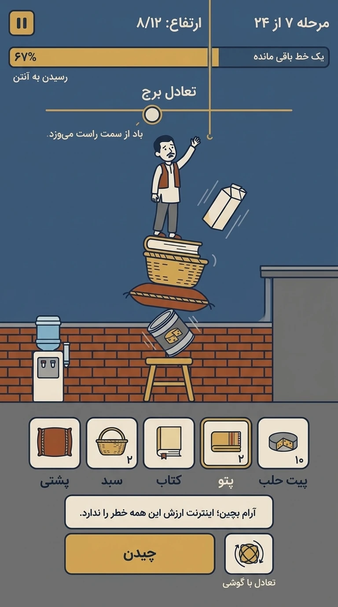
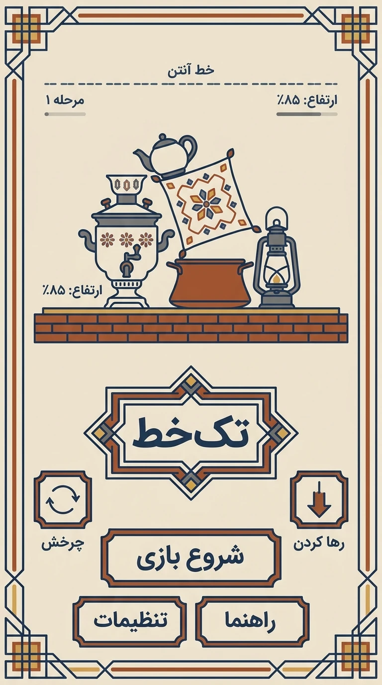

# تک‌خط

یک بازی کوچک فارسی ساخته‌شده با Godot 4. بازی درباره چیدن وسایل روی هم برای رسیدن به خط آنتن است.

## نیازمندی‌ها

- Godot Engine 4.x؛ پروژه در ابتدا با Godot 4.2 تنظیم شده است.
- برای خروجی Android: export templates متناظر با همان نسخه Godot و Android SDK/Java سازگار با مستندات Godot.

## اجرا

1. در Godot، فایل `project.godot` را باز کنید.
2. صحنه اصلی `Main.tscn` است. می‌توانید بازی را از ادیتور اجرا کنید.

## ساخت APK

از ریشه پروژه اجرا کنید:

- Linux/macOS: `./build-apk.sh`
- Windows: `build-apk.bat`

هر دو اسکریپت preset با نام `Android` را اجرا می‌کنند و فایل APK را در `build/tak_khat.apk` می‌سازند. در Linux/macOS مسیر Godot را با `GODOT=/path/to/godot` و در Windows با `GODOT_BIN` تنظیم کنید. ابزارهای Godot، Java، Android SDK و export templates باید از قبل نصب/پیکربندی شده باشند.

## GitHub Actions

Workflow در `.github/workflows/android.yml` هنگام push، pull request و اجرای دستی، پروژه را import و بررسی کرده و APK دیباگ را به‌صورت artifact با نام `tak-khat-android-debug` بارگذاری می‌کند. APK در مخزن commit نمی‌شود.

## ساختار مخزن

- `project.godot`, `Main.tscn`, `game.gd`: پروژه، صحنه و منطق بازی
- `assets/Vazir.ttf`: فونت
- `assets/*-reference.webp`: تصاویر مرجع پیوست‌شده
- `export_presets.cfg`: preset خروجی Android
- `build-apk.sh`, `build-apk.bat`: اسکریپت‌های ساخت
- `.github/workflows/android.yml`: ساخت خودکار در GitHub Actions

## تصاویر مرجع

## مشارکت و مجوز

تغییرات را در branch جداگانه انجام دهید و Pull Request همراه با شرح تغییر و آزمون‌های انجام‌شده باز کنید. مجوزی برای این پروژه تعیین نشده است؛ پیش از بازنشر یا استفاده از فایل‌ها، مجوز صاحب اثر را بررسی کنید.
